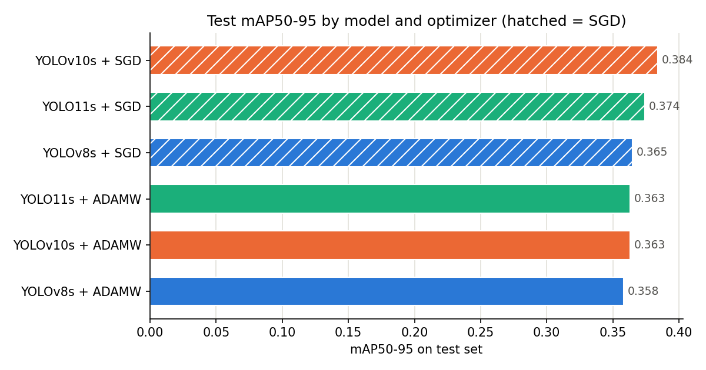
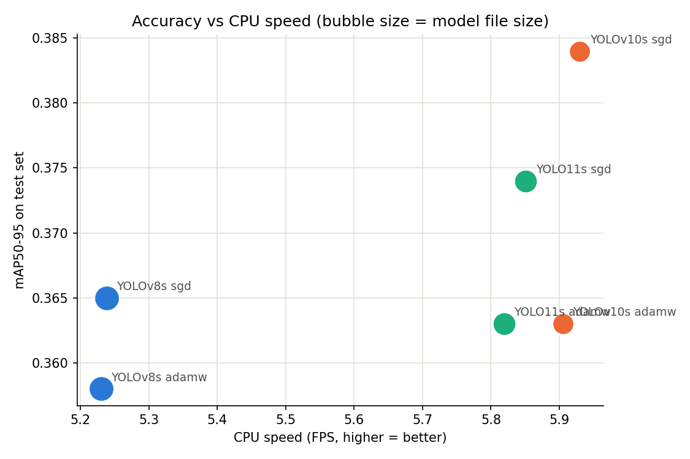

# Road Damage Detection with YOLO

An end-to-end computer vision project for detecting and localizing road damage in images. The project benchmarks three YOLO model families, evaluates detection quality and inference efficiency, tunes the strongest initial configuration, and provides a Gradio application for interactive inference.

## Project Overview

- **Task:** Object detection and localization of road damage.
- **Classes:** `alligator`, `block`, `crack`, `edge`, `longitudinal`, `pothole`, and `transverse`.
- **Dataset:** [Road Damage on Roboflow Universe](https://universe.roboflow.com/trafficsignssafeway/road-damage-l1ju7), published by TrafficSignsSafeway under **CC BY 4.0**.
- **Models benchmarked:** YOLOv8s, YOLOv10s, and YOLO11s.
- **Final configuration:** YOLOv10s + SGD, with `lr0 = 0.005`.
- **Application:** Gradio interface in `app.py`.

The source dataset page reports 6,768 images. The effective split used in the experiments contains 4,930 training, 1,146 validation, and 681 test images (6,757 images in total). Ultralytics skipped five training images and four validation images because their label files mixed polygon and bounding-box rows. The source dataset count and effective split count do not fully reconcile in the current export.

## Workflow

1. **Dataset preparation and exploratory analysis:** inspected the dataset and class distribution, configured the dataset YAML, and prepared the train/validation/test splits.
2. **Model benchmarking:** trained YOLOv8s, YOLOv10s, and YOLO11s with two optimizer configurations each.
3. **Evaluation:** compared precision, recall, mAP, mean IoU, inference speed, model size, and parameter count on the held-out test set.
4. **Hyperparameter tuning:** ran additional controlled experiments on the best initial configuration, changing one setting per run.
5. **Deployment:** integrated the final weights into a Gradio application for image-based detection and results inspection.

## Training Setup

The initial benchmark consisted of six runs using COCO-pretrained weights with Ultralytics 8.4 on a Kaggle NVIDIA Tesla T4 GPU.

| Setting | Value |
|---|---|
| Model families | YOLOv8s, YOLOv10s, YOLO11s |
| Optimizers | AdamW and SGD |
| AdamW learning rate (`lr0`) | 0.001 |
| SGD learning rate (`lr0`) | 0.01 |
| Epochs | 40 |
| Image size | 640 |
| Batch size | 16 |
| Early-stopping patience | 10 |
| Random seed | 0 |

For the second tuning round, YOLOv10s + SGD was tested on a Google Colab Tesla T4. Each experiment changed one setting relative to the baseline: epochs, image size, or learning rate.

## Initial Model Benchmark — Test Set

The table below compares the six initial training runs. The baseline YOLOv10s + SGD run achieved the best initial `mAP50-95` and was selected for further tuning.

| Run | mAP50 | mAP50-95 | Precision | Recall | Mean IoU¹ | Size (MB) | Params (M) | GPU FPS² | CPU FPS³ |
|---|---:|---:|---:|---:|---:|---:|---:|---:|---:|
| **YOLOv10s + SGD** | **0.612** | **0.384** | 0.597 | 0.595 | 0.778 | **16.5** | **7.2** | 96.7 | 6.7 |
| YOLO11s + SGD | 0.600 | 0.374 | 0.587 | 0.591 | 0.779 | 19.2 | 9.4 | 93.0 | 6.5 |
| YOLOv8s + SGD | 0.592 | 0.365 | 0.590 | 0.578 | 0.775 | 22.5 | 11.1 | 95.9 | 5.7 |
| YOLOv10s + AdamW | 0.600 | 0.363 | 0.615 | 0.565 | 0.777 | 16.5 | 7.2 | 95.7 | 6.6 |
| YOLO11s + AdamW | 0.585 | 0.363 | 0.565 | 0.584 | 0.780 | 19.2 | 9.4 | 89.5 | 6.5 |
| YOLOv8s + AdamW | 0.580 | 0.358 | 0.616 | 0.555 | 0.776 | 22.5 | 11.1 | 88.1 | 5.7 |

- **mAP50** measures detection quality at an IoU threshold of 0.50.
- **mAP50-95** averages AP across IoU thresholds from 0.50 to 0.95 and is the more informative metric here for localization quality.
- **Mean IoU¹** is calculated for detections matched to a ground-truth box of the same class, using confidence ≥ 0.25 and IoU ≥ 0.50. Because of this matching rule, its values are necessarily at least 0.50 and it does not distinguish the models as clearly as mAP50-95.
- **GPU FPS²** is end-to-end throughput (preprocessing, inference, and postprocessing), measured at batch size 1 and image size 640 on a Tesla T4.
- **CPU FPS³** was measured at batch size 1 on the Kaggle CPU using 100 test images.
- Repeated speed runs for the same architecture differed by approximately 5%, so small FPS differences should not be over-interpreted.

## Per-Class AP50 — Initial SGD Runs

| Class | YOLOv8s | YOLOv10s | YOLO11s |
|---|---:|---:|---:|
| block | 0.842 | **0.874** | 0.848 |
| crack | 0.830 | **0.854** | 0.839 |
| pothole | 0.695 | 0.697 | 0.696 |
| transverse | 0.600 | **0.628** | 0.618 |
| alligator | 0.345 | **0.358** | 0.344 |
| longitudinal | 0.241 | **0.261** | 0.258 |

The `edge` class had zero instances in the test set (21 in training and 1 in validation), so it could not be evaluated on the test set. The per-class table therefore reports the six classes that had test instances.

## Hyperparameter Tuning — YOLOv10s + SGD

After the initial benchmark, three additional experiments changed one setting at a time. The best configuration used `lr0 = 0.005`.

| Run | Image size | Epochs | Val mAP50-95 | Test mAP50 | Test mAP50-95 | Precision | Recall | GPU FPS¹ | Size (MB) |
|---|---:|---:|---:|---:|---:|---:|---:|---:|---:|
| Baseline (`lr0 = 0.01`) | 640 | 40 | 0.256 | 0.612 | 0.384 | 0.597 | 0.595 | 96.7 (Kaggle) | 16.5 |
| 80 epochs | 640 | 80 | 0.253 | 0.600 | 0.376 | 0.598 | 0.599 | 69.4 (Colab) | 16.5 |
| Image size 800 | 800 | 40 | 0.251 | 0.610 | 0.377 | 0.607 | 0.577 | 46.3 (Colab) | 16.5 |
| **`lr0 = 0.005` (final)** | **640** | **40** | **0.259** | **0.621** | **0.390** | 0.600 | 0.621 | 73.4 (Colab) | 16.5 |

¹ The baseline speed was measured on Kaggle, while the other tuning runs were measured on Colab. Only the Colab figures should be compared directly with one another.

Final-model AP50 by class:

| Class | AP50 |
|---|---:|
| block | 0.889 |
| crack | 0.859 |
| pothole | 0.693 |
| transverse | 0.657 |
| alligator | 0.361 |
| longitudinal | 0.268 |

### What the experiments showed

- **The lower learning rate gave the strongest result in these runs.** Moving from `lr0 = 0.01` to `0.005` increased test mAP50-95 from 0.384 to 0.390 and validation mAP50-95 from 0.256 to 0.259. The gain is small and comes from a single seed, so it should be treated as a slight edge rather than a proven improvement.
- **More epochs did not improve the result.** The 80-epoch run reached test mAP50-95 of 0.376, below the baseline value of 0.384. Validation mAP50-95 had plateaued around 0.25 after roughly epoch 55.
- **Larger images did not improve overall mAP.** Image size 800 reached 0.377 test mAP50-95 and reduced measured throughput by about 35%. It gave small AP50 gains on the thin classes (`longitudinal` and `alligator`), but those gains did not change the overall result.

## Analysis and Key Findings

- **The three model families were close in accuracy.** Across the six initial runs, the `mAP50-95` range was 0.026. Since each model configuration used one seed, small differences should not be treated as conclusive.
- **SGD performed better than AdamW in all three model families in the initial test runs**, with `mAP50-95` gains ranging from 0.007 to 0.021. This is a consistent trend in these experiments, not proof that SGD will always be better.
- **The final model balances detection quality and model footprint.** The tuned YOLOv10s + SGD model reached test mAP50-95 of 0.390 in the second tuning round and has a reported weight-file size of 16.5 MB.
- **Performance varied substantially by class.** The model detected `block` and `crack` relatively well, while `longitudinal` and `alligator` remained difficult. These classes can be thin, irregular, visually similar, and inconsistently annotated.
- **The dataset is imbalanced.** The training annotations contain 6,075 `pothole` boxes, 4,337 `alligator` boxes, and 2,008 `longitudinal` boxes, compared with 305 `block` boxes and 21 `edge` boxes.
- **Per-class metrics vary between splits.** For example, `crack` AP50 was approximately 0.26–0.29 on validation (223 boxes) and 0.83 on test (93 boxes). Differences in class proportions and the limited number of boxes make some per-class estimates unstable.
- **Measured throughput depends on hardware.** The initial end-to-end GPU runs were around 88–97 FPS on a Tesla T4, while CPU inference was around 5.7–6.7 FPS in the stated test setup. These are benchmark measurements, not a guarantee for every deployment device.

## Results Visualizations

### Model mAP Comparison



### Inference Speed Comparison



## Limitations

- Hyperparameter search was limited to optimizer, learning rate, epoch count, and image size, with one change per run; there was no combined search.
- Each configuration was evaluated with a single random seed. Differences below approximately 0.01 mAP50-95 should not be treated as reliable improvements without repeated runs.
- The `edge` class is effectively absent from the evaluation data and cannot be assessed on the test set.
- The test set contains 681 images and 2,004 boxes, so some per-class metrics—especially for underrepresented classes—are sensitive to the split.
- The model is a learning and demonstration project, not a validated system for official road-safety inspection or maintenance decisions.

## Run the Gradio App Locally

1. Clone or download this repository.
2. Install the dependencies:

   ```bash
   pip install -r requirements.txt
   ```

3. Place the final tuned model weights next to `app.py` and name the file `best.pt`. The original tuned weights file is `v10s_sgd_lr0005.pt`. Alternatively, set the `MODEL_PATH` environment variable to the model file location.
4. Start the app:

   ```bash
   python app.py
   ```

5. Open [http://127.0.0.1:7860](http://127.0.0.1:7860) in your browser.

To create a temporary public sharing link while the app is running, use:

```bash
python app.py --share
```

The temporary link only works while the application process remains active. Persistent hosting is not configured in this repository; check the hosting provider's current requirements before deploying.

## Repository Contents

- `app.py` — Gradio application.
- `best.pt` — final tuned YOLOv10s weights (after renaming `v10s_sgd_lr0005.pt`).
- `requirements.txt` — Python dependencies.
- `notebooks/` — dataset setup, EDA, training, evaluation, and tuning notebooks.
- `images/` — model-comparison visualizations.

## Credits

- **Dataset:** [Road Damage](https://universe.roboflow.com/trafficsignssafeway/road-damage-l1ju7) by TrafficSignsSafeway on Roboflow Universe, licensed under **CC BY 4.0**.
- **Models and training framework:** [Ultralytics YOLO](https://docs.ultralytics.com/).
# Road Damage Detection with YOLO

An end-to-end computer vision project for detecting and localizing road damage in images. The project benchmarks three YOLO model families, evaluates detection quality and inference efficiency, tunes the strongest initial configuration, and provides a Gradio application for interactive inference.

## Project Overview

- **Task:** Object detection and localization of road damage.
- **Classes:** `alligator`, `block`, `crack`, `edge`, `longitudinal`, `pothole`, and `transverse`.
- **Dataset:** [Road Damage on Roboflow Universe](https://universe.roboflow.com/trafficsignssafeway/road-damage-l1ju7), published by TrafficSignsSafeway under **CC BY 4.0**.
- **Models benchmarked:** YOLOv8s, YOLOv10s, and YOLO11s.
- **Final configuration:** YOLOv10s + SGD, with `lr0 = 0.005`.
- **Application:** Gradio interface in `app.py`.

The source dataset page reports 6,768 images. The effective split used in the experiments contains 4,930 training, 1,146 validation, and 681 test images (6,757 images in total). Ultralytics skipped five training images and four validation images because their label files mixed polygon and bounding-box rows. The source dataset count and effective split count do not fully reconcile in the current export.

## Workflow

1. **Dataset preparation and exploratory analysis:** inspected the dataset and class distribution, configured the dataset YAML, and prepared the train/validation/test splits.
2. **Model benchmarking:** trained YOLOv8s, YOLOv10s, and YOLO11s with two optimizer configurations each.
3. **Evaluation:** compared precision, recall, mAP, mean IoU, inference speed, model size, and parameter count on the held-out test set.
4. **Hyperparameter tuning:** ran additional controlled experiments on the best initial configuration, changing one setting per run.
5. **Deployment:** integrated the final weights into a Gradio application for image-based detection and results inspection.

## Training Setup

The initial benchmark consisted of six runs using COCO-pretrained weights with Ultralytics 8.4 on a Kaggle NVIDIA Tesla T4 GPU.

| Setting | Value |
|---|---|
| Model families | YOLOv8s, YOLOv10s, YOLO11s |
| Optimizers | AdamW and SGD |
| AdamW learning rate (`lr0`) | 0.001 |
| SGD learning rate (`lr0`) | 0.01 |
| Epochs | 40 |
| Image size | 640 |
| Batch size | 16 |
| Early-stopping patience | 10 |
| Random seed | 0 |

For the second tuning round, YOLOv10s + SGD was tested on a Google Colab Tesla T4. Each experiment changed one setting relative to the baseline: epochs, image size, or learning rate.

## Initial Model Benchmark — Test Set

The table below compares the six initial training runs. The baseline YOLOv10s + SGD run achieved the best initial `mAP50-95` and was selected for further tuning.

| Run | mAP50 | mAP50-95 | Precision | Recall | Mean IoU¹ | Size (MB) | Params (M) | GPU FPS² | CPU FPS³ |
|---|---:|---:|---:|---:|---:|---:|---:|---:|---:|
| **YOLOv10s + SGD** | **0.612** | **0.384** | 0.597 | 0.595 | 0.778 | **16.5** | **7.2** | 96.7 | 6.7 |
| YOLO11s + SGD | 0.600 | 0.374 | 0.587 | 0.591 | 0.779 | 19.2 | 9.4 | 93.0 | 6.5 |
| YOLOv8s + SGD | 0.592 | 0.365 | 0.590 | 0.578 | 0.775 | 22.5 | 11.1 | 95.9 | 5.7 |
| YOLOv10s + AdamW | 0.600 | 0.363 | 0.615 | 0.565 | 0.777 | 16.5 | 7.2 | 95.7 | 6.6 |
| YOLO11s + AdamW | 0.585 | 0.363 | 0.565 | 0.584 | 0.780 | 19.2 | 9.4 | 89.5 | 6.5 |
| YOLOv8s + AdamW | 0.580 | 0.358 | 0.616 | 0.555 | 0.776 | 22.5 | 11.1 | 88.1 | 5.7 |

- **mAP50** measures detection quality at an IoU threshold of 0.50.
- **mAP50-95** averages AP across IoU thresholds from 0.50 to 0.95 and is the more informative metric here for localization quality.
- **Mean IoU¹** is calculated for detections matched to a ground-truth box of the same class, using confidence ≥ 0.25 and IoU ≥ 0.50. Because of this matching rule, its values are necessarily at least 0.50 and it does not distinguish the models as clearly as mAP50-95.
- **GPU FPS²** is end-to-end throughput (preprocessing, inference, and postprocessing), measured at batch size 1 and image size 640 on a Tesla T4.
- **CPU FPS³** was measured at batch size 1 on the Kaggle CPU using 100 test images.
- Repeated speed runs for the same architecture differed by approximately 5%, so small FPS differences should not be over-interpreted.

## Per-Class AP50 — Initial SGD Runs

| Class | YOLOv8s | YOLOv10s | YOLO11s |
|---|---:|---:|---:|
| block | 0.842 | **0.874** | 0.848 |
| crack | 0.830 | **0.854** | 0.839 |
| pothole | 0.695 | 0.697 | 0.696 |
| transverse | 0.600 | **0.628** | 0.618 |
| alligator | 0.345 | **0.358** | 0.344 |
| longitudinal | 0.241 | **0.261** | 0.258 |

The `edge` class had zero instances in the test set (21 in training and 1 in validation), so it could not be evaluated on the test set. The per-class table therefore reports the six classes that had test instances.

## Hyperparameter Tuning — YOLOv10s + SGD

After the initial benchmark, three additional experiments changed one setting at a time. The best configuration used `lr0 = 0.005`.

| Run | Image size | Epochs | Val mAP50-95 | Test mAP50 | Test mAP50-95 | Precision | Recall | GPU FPS¹ | Size (MB) |
|---|---:|---:|---:|---:|---:|---:|---:|---:|---:|
| Baseline (`lr0 = 0.01`) | 640 | 40 | 0.256 | 0.612 | 0.384 | 0.597 | 0.595 | 96.7 (Kaggle) | 16.5 |
| 80 epochs | 640 | 80 | 0.253 | 0.600 | 0.376 | 0.598 | 0.599 | 69.4 (Colab) | 16.5 |
| Image size 800 | 800 | 40 | 0.251 | 0.610 | 0.377 | 0.607 | 0.577 | 46.3 (Colab) | 16.5 |
| **`lr0 = 0.005` (final)** | **640** | **40** | **0.259** | **0.621** | **0.390** | 0.600 | 0.621 | 73.4 (Colab) | 16.5 |

¹ The baseline speed was measured on Kaggle, while the other tuning runs were measured on Colab. Only the Colab figures should be compared directly with one another.

Final-model AP50 by class:

| Class | AP50 |
|---|---:|
| block | 0.889 |
| crack | 0.859 |
| pothole | 0.693 |
| transverse | 0.657 |
| alligator | 0.361 |
| longitudinal | 0.268 |

### What the experiments showed

- **The lower learning rate gave the strongest result in these runs.** Moving from `lr0 = 0.01` to `0.005` increased test mAP50-95 from 0.384 to 0.390 and validation mAP50-95 from 0.256 to 0.259. The gain is small and comes from a single seed, so it should be treated as a slight edge rather than a proven improvement.
- **More epochs did not improve the result.** The 80-epoch run reached test mAP50-95 of 0.376, below the baseline value of 0.384. Validation mAP50-95 had plateaued around 0.25 after roughly epoch 55.
- **Larger images did not improve overall mAP.** Image size 800 reached 0.377 test mAP50-95 and reduced measured throughput by about 35%. It gave small AP50 gains on the thin classes (`longitudinal` and `alligator`), but those gains did not change the overall result.

## Analysis and Key Findings

- **The three model families were close in accuracy.** Across the six initial runs, the `mAP50-95` range was 0.026. Since each model configuration used one seed, small differences should not be treated as conclusive.
- **SGD performed better than AdamW in all three model families in the initial test runs**, with `mAP50-95` gains ranging from 0.007 to 0.021. This is a consistent trend in these experiments, not proof that SGD will always be better.
- **The final model balances detection quality and model footprint.** The tuned YOLOv10s + SGD model reached test mAP50-95 of 0.390 in the second tuning round and has a reported weight-file size of 16.5 MB.
- **Performance varied substantially by class.** The model detected `block` and `crack` relatively well, while `longitudinal` and `alligator` remained difficult. These classes can be thin, irregular, visually similar, and inconsistently annotated.
- **The dataset is imbalanced.** The training annotations contain 6,075 `pothole` boxes, 4,337 `alligator` boxes, and 2,008 `longitudinal` boxes, compared with 305 `block` boxes and 21 `edge` boxes.
- **Per-class metrics vary between splits.** For example, `crack` AP50 was approximately 0.26–0.29 on validation (223 boxes) and 0.83 on test (93 boxes). Differences in class proportions and the limited number of boxes make some per-class estimates unstable.
- **Measured throughput depends on hardware.** The initial end-to-end GPU runs were around 88–97 FPS on a Tesla T4, while CPU inference was around 5.7–6.7 FPS in the stated test setup. These are benchmark measurements, not a guarantee for every deployment device.

## Results Visualizations

### Model mAP Comparison


### Inference Speed Comparison


## Limitations

- Hyperparameter search was limited to optimizer, learning rate, epoch count, and image size, with one change per run; there was no combined search.
- Each configuration was evaluated with a single random seed. Differences below approximately 0.01 mAP50-95 should not be treated as reliable improvements without repeated runs.
- The `edge` class is effectively absent from the evaluation data and cannot be assessed on the test set.
- The test set contains 681 images and 2,004 boxes, so some per-class metrics—especially for underrepresented classes—are sensitive to the split.
- The model is a learning and demonstration project, not a validated system for official road-safety inspection or maintenance decisions.

## Run the Gradio App Locally

1. Clone or download this repository.
2. Install the dependencies:

   ```bash
   pip install -r requirements.txt
   ```

3. Place the final tuned model weights next to `app.py` and name the file `best.pt`. The original tuned weights file is `v10s_sgd_lr0005.pt`. Alternatively, set the `MODEL_PATH` environment variable to the model file location.
4. Start the app:

   ```bash
   python app.py
   ```

5. Open [http://127.0.0.1:7860](http://127.0.0.1:7860) in your browser.

To create a temporary public sharing link while the app is running, use:

```bash
python app.py --share
```

The temporary link only works while the application process remains active. Persistent hosting is not configured in this repository; check the hosting provider's current requirements before deploying.

## Repository Contents

- `app.py` — Gradio application.
- `best.pt` — final tuned YOLOv10s weights (after renaming `v10s_sgd_lr0005.pt`).
- `requirements.txt` — Python dependencies.
- `notebooks/` — dataset setup, EDA, training, evaluation, and tuning notebooks.
- `images/` — model-comparison visualizations.

## Credits

- **Dataset:** [Road Damage](https://universe.roboflow.com/trafficsignssafeway/road-damage-l1ju7) by TrafficSignsSafeway on Roboflow Universe, licensed under **CC BY 4.0**.
- **Models and training framework:** [Ultralytics YOLO](https://docs.ultralytics.com/).
